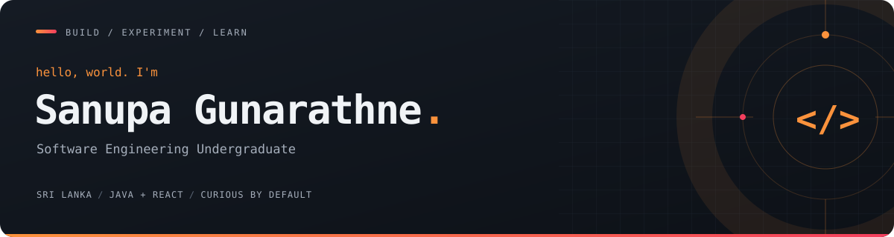

  

  <strong>Full-stack development &nbsp;·&nbsp; Java & OOP &nbsp;·&nbsp; Exploring IoT + ML</strong>

  
  
  

  

## A little about me

🎓 Second-year **Software Engineering undergraduate** at **IIT Sri Lanka**, on the **University of Westminster** partner programme.

💻 Building with **Java, Spring Boot, and React** — learning through practical projects and experimentation.

🏎️ Exploring **karting telemetry, IoT sensors, and ML-based analysis** with my team.

🌱 Currently learning **ASP.NET Core** and strengthening my **OOP and full-stack foundations**.

## My toolkit

<strong>Languages</strong>

   &nbsp;&nbsp;
   &nbsp;&nbsp;
   &nbsp;&nbsp;
  

<strong>Frameworks &amp; database</strong>

   &nbsp;&nbsp;
   &nbsp;&nbsp;
  

<strong>Development &amp; testing</strong>

   &nbsp;&nbsp;
   &nbsp;&nbsp;
   &nbsp;&nbsp;
   &nbsp;&nbsp;
  

  <strong>Currently learning</strong>  
   
  ASP.NET Core &nbsp;·&nbsp; IoT &nbsp;·&nbsp; Machine Learning

## GitHub at a glance

  

   
  Language breakdown reflects repository code, not proficiency.

---

  <strong>Code → sensors → data → insights</strong> 
  Outside the screen: motorcycle rides · scouting · tennis

  <a href="https://github.com/sanuoa?tab=repositories"><strong>Explore what I'm building ↗</strong></a>

